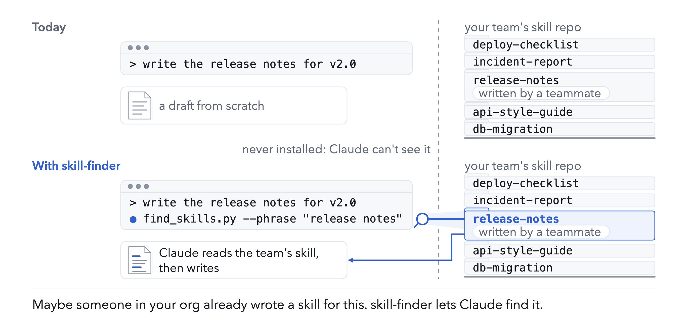
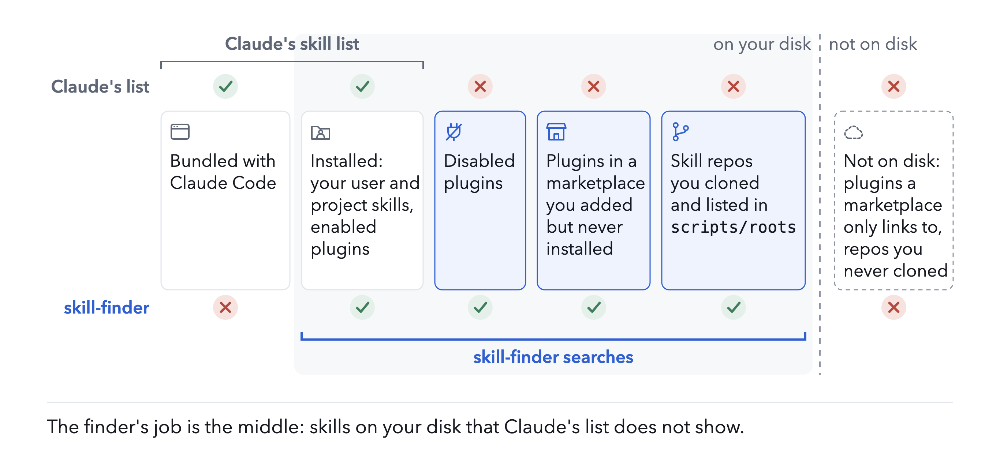
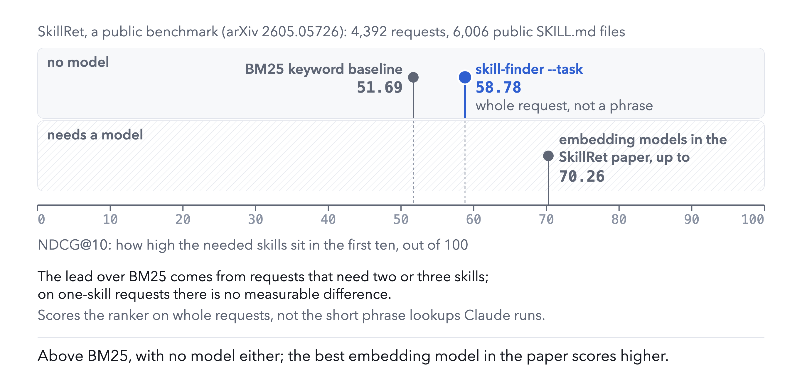

# skill-finder

**Maybe someone in your org already wrote a skill for this.**

<picture>
  <source media="(prefers-color-scheme: dark)" srcset="docs/images/situation-dark.png">
  
</picture>

Your company keeps Claude Code skills in a few repos or plugin marketplaces, or you added a marketplace once and forgot what
is in it. You haven't read them all, and you won't install them all. But for the task in front of you, one may already
exist. skill-finder searches every skill on your machine (installed, disabled, or never installed but shipped inside a
marketplace Claude Code cloned) plus any skill repo you have cloned and listed in `scripts/roots`. It lists the skills that
contain the words Claude looks up, in their `SKILL.md` or in their reference files, each with its path and the line that
matched. Claude can then read the one that fits, or
you can copy it into a folder you start a fresh session in. It never edits `settings.json`; beyond the folder you clone, the
only change to your setup is the `CLAUDE.md` lines you add.

What the tests show: with the `CLAUDE.md` block, Sonnet runs the finder and opens skills it could not otherwise see (one in 44
of 50 runs, against none in 30 runs without the block; ten requests, the first turn only); Haiku, on the same requests, mostly
answered without running it. What they do not show: that the finished work is better. In my own sessions in the nine days after
I added the block, the finder ran in 6 of 26, and in 2 of them a skill it listed was invoked or its `SKILL.md` read afterwards.
The tests are under [Does it work?](#does-it-work).

**Why not just enable them?** Enable the plugins you know you need. Claude Code gives its skill list a budget of 1% of the
context window and, past that, drops the descriptions of the skills you invoke least, keeping their names; a 200-skill Haiku
test could not measure any harm from that.
The finder is for the skills you cannot enable without first finding them: in a marketplace you added but never installed, in
a team or public repo you cloned, or in a plugin you turned off.

The `CLAUDE.md` block below (about 220 tokens in every session) has Claude look the skills up before a task's first edit. A
lookup lists at most 10 skills whose `SKILL.md` holds the phrase (and up to 5 that hold it only in reference files), each with
its description and the line that matched: in my tests about 3,800 characters in the median, up to about 8,800. Claude can
read most skills from their files without enabling them; whether it then follows one as well as an enabled skill is not
measured.

<picture>
  <source media="(prefers-color-scheme: dark)" srcset="docs/images/where-it-looks-dark.png">
  
</picture>

Claude will not reach for the finder by itself, so it comes with a short instruction for your `CLAUDE.md` (below). It pays
off most for skills Claude cannot see; for skills Claude already lists, the tests found little gain, except for a second
need that shows only in the files (the optional `Second lookups` section below).

## What a lookup looks like

```
$ python3 scripts/find_skills.py --phrase "release notes" --only tests/fixtures/skills
phrase search: "release notes" in the SKILL.md and reference files of 18 skills on disk (a phrase starts a word: 'plan' matches 'planning', not 'airplane')
1 skill(s) contain it. Best first: the phrase in the name, then in the description, then how often it occurs.

1. release-notes  [folder skill]  tests/fixtures/skills/release-notes/SKILL.md
   Draft release notes and changelog entries from merged pull requests.
   :6: # release-notes

Best match: release-notes  tests/fixtures/skills/release-notes/SKILL.md
Why: "release notes" is in its name and its description and 3 times in SKILL.md (line 6: "# release-notes")
Description: Draft release notes and changelog entries from merged pull requests.
First lines of SKILL.md:
  # release-notes

  Group by change type.
Read tests/fixtures/skills/release-notes/SKILL.md, then follow it; search again only if it does not fit.
```

That is the repo's test fixtures. On your machine each hit shows its state, such as `user skill`, `project skill`, `plugin
enabled`, `plugin DISABLED`, `plugin installed for <project> only` (installed for other repos or folders, so it does not load
here), `plugin cached, other version` (another version left in the cache; Claude Code loads the installed one), `marketplace
only, not installed`, or `extra root` (a folder you added, which Claude Code itself does not load). The states come from the
install records and the settings a session started in the current folder reads: your `settings.json`, then that folder's
`.claude/settings.json`, then `settings.local.json` there and at its git repo root (for a linked worktree, the main checkout's
root, so an entry the `/skills` menu saved there reaches the worktree). A folder whose own settings enable a plugin
gets it, even one installed only for another project. A user or project skill that `skillOverrides` in those files hides or
shortens (an entry under its folder name, not its frontmatter `name`) says so: `user skill, off in settings` (hidden from
Claude and from the `/` menu), `user skill, user-invocable only in settings` (in your
`/` menu, hidden from Claude) or `user skill, name only in settings` (Claude gets its name without the description), and
`project skill, ...` alike; plugin skills are not affected. That holds for the config dir a session uses (`$CLAUDE_CONFIG_DIR`, else
`~/.claude`); when the finder scans both, the other one is labelled by its own `settings.json` (an old version's copy still
reads `plugin cached, other version`), and where both hold the same skill the copy shown is the one in use. The labels can still
disagree with a live session. A skill Claude Code does not load can be read from its path, or copied with `--enable NAME
--into DIR` into `DIR/.claude/skills`, so a session started in `DIR` can invoke it (a plugin skill whose scripts use
`CLAUDE_PLUGIN_ROOT` may not work from the copy; the finder warns). The copy is a project skill in a folder of the skill's bare
name, so `skillOverrides` set to `off` or `user-invocable-only` for that folder name in the files a session started in `DIR`
reads (the ones above) keeps Claude from invoking it, and a user skill in a folder of that name runs instead of it (personal
beats project); the finder warns in both cases. The same entry also hides the original wherever that file is read (always for a user skill, or for
an entry in your `settings.json`); for a plugin skill only the copy is hidden, since `skillOverrides` does not apply to plugin skills. An entry in
another project's `.claude/settings.local.json`, where the `/skills` menu saves it, does not reach `DIR`.

## Why not just grep?

`--phrase` is close to a `grep -ril` over every `SKILL.md`, cut to the best 10 (`--limit 40` for more), plus up to five skills that hold the phrase only in their
reference files. In a small Haiku test (four tasks over one folder of 927 public skills, run before the finder read
reference files), Claude found the right skill about as often with plain `grep` over `SKILL.md` files. What the finder adds is around the match:

- **Where to look.** It knows where Claude Code keeps skills: user and project folders and every plugin's skills in each
  config dir, including disabled plugins and the marketplace folders of plugins you never installed, plus the folders in
  `scripts/roots`.
- **What each hit is.** Its state, path, description and the line that matched. Copies of one skill (a plugin's cache and
  its marketplace folder) are shown once.
- **Order.** The phrase in the name first, then in the description, then by how often it occurs, not by folder order. A
  phrase starts a word and ignores case, and its words match across spaces, hyphens and underscores ("release notes" finds
  `release-notes`).
- **Reference files.** Many skills keep most of their text in reference files (`.md` and `.txt` files in the skill's
  folder, `references/` first; log, test and hidden folders are skipped). A skill that holds the phrase only there is listed
  after the `SKILL.md` hits, up to five, with the file and line. A listed skill's row also shows, with file and line, each
  looked-up phrase that only its reference files hold (up to three), and then the names of its reference files (up to
  eight: those that hold the looked-up phrases come first, and a phrase that few of the skill's files hold counts most). In a small Sonnet test on 16 made-up skills with long files (20 cases where the rule sat in a reference file of a
  skill about another topic), Claude followed the rule in 20 cases with these lines against 8 without them; with the
  reference files renamed `part-1.md` and so on, in 15 against 5. The file-and-line hits did that work: the list of names
  led Claude to the file only when the names said what was inside. A lookup's output grows by about 6 to 20%. In a replay of 894 lookups recorded in four test tasks (no
  model), the right skill was in the first ten for 213 of the 294 lookups that no `SKILL.md` matched, against 205 without it
  (first three: 126 against 113). All of the gain at ten came from one task, whose words sit in its reference files; the
  other three neither gained nor lost there.
- **No match.** It says how many skills hold each word (in `SKILL.md` or reference files) and usually lists the skills
  nearest by words.

`--task` is a keyword ranking instead (a word in the name counts most, then the description, then the body; rare words
count more). It is the part the public benchmark below scores.

## Set up

1. **Install the skill.** `git clone https://github.com/ydmitry/skill-finder ~/.claude/skills/skill-finder` (or copy the
   folder to a project's `.claude/skills/`). Python 3, standard library only; PyYAML is used for the front matter when it is
   installed. The `CLAUDE.md` block below calls the script directly; the skill's own `SKILL.md` is for when you or Claude
   invoke `skill-finder` for a fuller search and a report on which skill to use and how.
2. **Point it at your org's skills.** It already scans user skills, project skills (`.claude/skills` up from the working
   folder) and every plugin's skills in each config dir (`~/.claude`, and `$CLAUDE_CONFIG_DIR` when set): enabled plugins,
   disabled ones, installed ones that `settings.json` does not list, and the marketplace folders of plugins you never
   installed, under `plugins/marketplaces`. So a marketplace that Claude Code cloned when you added it is searched as it
   is, except plugins it only links to in other repos, which are not on disk until you install them. For a skill repo
   that is not a marketplace, clone it once and add its folder (for a marketplace added from a local folder, that folder) to
   `scripts/roots` (copy `scripts/roots.example`; one folder per line, machine-local, not committed). It cannot see Claude
   Code's bundled skills.
3. **Add the instruction to your `CLAUDE.md`.** Put this in your global `~/.claude/CLAUDE.md` (or a project's `CLAUDE.md`),
   and change the path if you installed the skill elsewhere:

```
## Skills
Before the first edit of a task, and again when the work turns to a new tool, file type, service or document kind, look the skills up by phrase:
  python3 ~/.claude/skills/skill-finder/scripts/find_skills.py --phrase "<two or three words, in order>"
It lists the skills whose SKILL.md contains the phrase, best first. Look up several phrases, each from a different angle: what the work is about; what the finished thing is called; how one goes about it; its shape. Leave proper nouns out.
Open the best match's SKILL.md before writing anything, and follow it. Search again only if it does not fit. No match means proceed without a skill. Skip for one-line answers and when the task names its skills.
```

If your permission rules allow the finder by its command (for example
`Bash(python3 ~/.claude/skills/skill-finder/scripts/find_skills.py *)`), Claude Code checks each part of a chained command on
its own, so plain finder calls, one phrase each, alone or chained with `;` or `&&`, pass. A shell loop does not, nor does a `cd`
outside your working folders: expect a prompt, or a refusal in unattended runs. In a test, Opus put its phrases in a loop in
all 20 runs (14 of them as `cd /tmp && for p in ...; do ...; done`), and all 20 were refused. In the subagent variant below,
the line "Run one phrase per command, with no cd and no loop" kept every Opus subagent to plain calls; the block with that line
added is untested.

**A skill it finds is trusted like one you installed.** The block has Claude follow the best match, also when it comes from
a marketplace or repo you never installed and may never have read, and a `SKILL.md` can tell Claude to run its scripts.
The best match is picked by keywords, not by you: a phrase in a skill's name or description ranks it first, so any `SKILL.md`
in a searched source can put common phrases there.
Search only sources you would install from: the marketplaces you added are searched as they are, and `scripts/roots` holds
the rest. A plain read does not run a skill's `` !`command` `` lines, fill in `${CLAUDE_SKILL_DIR}` or `${CLAUDE_PLUGIN_ROOT}`,
or apply its frontmatter (`allowed-tools`, `context: fork`, `hooks`, `model`); such a skill works only when Claude Code loads
it: its plugin enabled, or a copy made with `--enable`, which runs `` !`command` `` lines and fills `${CLAUDE_SKILL_DIR}` but
not `${CLAUDE_PLUGIN_ROOT}`.

The tested text said "No match, or a LOW CONFIDENCE one"; only the keyword search (`--task`) prints `LOW CONFIDENCE`, never
`--phrase`, so that clause is left out here. The block costs about 220 tokens in every session. In a Haiku test on
unattended runs (such as `claude -p` with a task), a longer version of this text, not published here, got the skill opened in
15 of 15 runs when added to the task and in 9 of 15 when left in `CLAUDE.md`; the block above has not been tried in a task. The block predates reference hits: when only a skill's reference file
holds the phrase, the output names that skill and the file, which counts as a match. To see whether it works for
you, count the transcripts in which Claude ran the finder:

```
grep -rl --include='*.jsonl' '"name":"Bash".*find_skills\.py' "${CLAUDE_CONFIG_DIR:-$HOME/.claude}/projects" | wc -l
```

and look at whether a skill it listed is invoked afterwards.

**Optional: a second lookup mid-task.** The block already says to look again "when the work turns to a new tool, file type,
service or document kind", but in tests Claude mostly looked up the request's words, and rarely a second need that showed only
inside the files: a GPL-licensed file in a pull request under review, answers from under-16s in a survey, money stored as
floats in a bug fix. The `Second lookups` section below, pasted into the same `CLAUDE.md` right under the block (the tested
text and placement, word for word), asks for a lookup for each technology or kind of data the files show. Add it if your org
keeps skills for such needs. It is about two and a half times as long as the block (roughly 500 tokens in every session), it
adds lookups, and in tests it did not reach a business change such as a cut to a pricing plan; the tests are under "Does it
work?".

```
## Second lookups
The lookup is not a one-time step before the first edit. Every time a file you read shows a technology, a kind of data, a format or a service that the skills you opened do not cover, you MUST look the skills up again with its name, before you write about it. No exceptions.
Before you write findings or code, write one line: "Technologies and kinds of data in this work: ..." and, for each, the skill you looked up for it or "no skill found".

| Thought | Reality |
|---|---|
| "I already ran the lookup before the first edit" | That lookup used the request's words. What the files showed since are new facts; look them up. |
| "The skill I found fits the task" | It fits the request. A technology or a kind of data in the files is a second need with its own rules. |
| "The match is the same as last time, so I'll follow it" | Same phrases, same match. Search with the names the files show. |
| "The check failed, so I'll follow the first skill more closely" | Following one skill harder does not add the rules of another. Look up what the files show. |
| "This is a review, not an edit, so no skill is needed" | A review is where the team's rules matter most. |
| "Leave proper nouns out" | That is for phrasing the first search. A technology's name, or the kind of data, is the right phrase for a second one. |

Red flags, stop and look up: you are about to write about a file type, technology or kind of data that no skill you opened mentions; you are rerunning the first lookup's phrases; a check failed and you are only rewording.
Teams keep their rules for a technology or a kind of data in a skill. Work that skips them comes back incomplete, every time.
```

## Does it work?

In short: it helps Claude find and open skills it could not otherwise see, and adds little for skills Claude already lists,
except a second skill whose need shows only in the files (the optional `Second lookups` section).
Most tests measure whether Claude ran the finder and opened the skill, not whether the work came out better; the tests of the
`Second lookups` section check whether a skill's rules reached Claude before a check on the output asked for them. They were
run with Claude Haiku and Sonnet (the subagent tests also with Opus), their harness is not published (several tests run on one machine's own config and skills,
some of them private; the others on a local copy of 927 public skills that is not redistributed), and they are small: read
them as directions, not rates. The model tests ran when a `--phrase` lookup listed up to 40 skills, except the subagent tests, which
ran at today's default of 10. All the model tests except those of the `Second lookups` section and the subagent tests ran
before `--phrase` also read reference files. Two tests need no model: the
reference-file replay above, which replays the unpublished runs' lookups, and the benchmark in the last paragraph of this
section, whose scripts are published in `bench/skillret/`.

**Skills you have not installed** are the finder's main job. Ten skills from public repos that were not installed, and
requests written without any word of the skill's name or description (rejected by a check, then confirmed blind by a second
model that picked the right skill first for 8 of 10). Without the instruction, Sonnet ran the finder in none of 30 runs and
opened none of those skills. With it, it ran the finder in all 50 runs, had the target in a list in 78% of them, opened the
exact skill in 68%, and in 88% opened at least one skill it could not otherwise see, the right one or not. Seven of the ten skills were opened in four or five of
five runs; two of the misses were requests that fit another unseen skill as well, one was a short skill whose words the
request did not share. Ten skills, one model, the first turn only (nothing is written, so whether the skill was followed is
not measured), and requests written by a model that had read each skill: a direction, not a rate. A later Sonnet rerun at
today's default of 10 hits, counted more strictly (only skills opened before the reply reached 1,000 characters), opened an
unseen skill in 14 of 20 runs and the exact one in 11 of 20.

**Why the instruction is needed.** None of the `SKILL.md` descriptions tried, one of them saying "use at the start of EVERY
task", got the skill called: 0 of 232 runs. The models call the skill whose topic matches the task (a chart skill for a chart) and never a skill whose
job is to look for skills. On a machine with many skills Claude Code also drops the description of the ones you never
invoke, so the skill is often listed by name alone. What works better is a standing instruction in the system
instructions, next to the work.

**What the instruction does.** With it in the global `CLAUDE.md`, Sonnet ran the finder before its first edit in 8 of 8 test
runs (four tasks, two runs each) and in none of 4 one-line questions. With the lookup allowed it then opened a skill from the list in 6 of 8; in 4 of
those it was a skill it opens without the finder, and for the task whose best skill is not in its own skill list (a colour
theme) it opened the finder's pick in 2 of 2. Subagents read the same file and did the same in 8 of 8 delegated runs, at
about three lookups each before their first edit; a coordinator that only handed the task over looked nothing up (0 of 8),
so a coordinator's main conversation does not see those lookups. In placement tests with Haiku on unattended runs, a longer version of
this text in `CLAUDE.md` got the finder run every time, but the skill opened in 9 of 15 runs; added to the task itself, the
same text got it opened in 15 of 15. The line "open the best match's SKILL.md before writing anything" has not been measured.
On Haiku the block rarely fired on the ten unseen-skill requests, nine of which ask for a written answer rather than an edit:
in 18 of 20 runs Haiku answered with no tool call at all, and the 2 runs that ran the finder were both on the one request for a
file. Sonnet ran the finder first in all 20 runs on the same requests. In these runs the block came as an addition to the
system prompt, not from `CLAUDE.md`.

**The lookup in a subagent.** A variant of the block that hands the lookup to a subagent, tested against the block on Haiku,
Sonnet and Opus with a bar set before the runs, did not pass on any model. On Sonnet, the only model where both versions ran
their search, in the 7 pairs where both found the skill the main conversation still received 84% as much text: the finder's
output (about 30% of what the block put there) stayed out, but the subagent's report and the skill and its references, read
in the main conversation either way, made up the rest. On Sonnet it also cost about 1.5 times as much in total. On Haiku the
block's runs mostly made no tool call, and on Opus the allow rule refused the block's searches (above), so there was little to
compare. The block stays as it is.

**A second skill the files reveal mid-task** (the optional `Second lookups` section). Each test task asked for one thing
(review a pull request, summarise a survey, fix a bug) and hid a second need in its files. A scripted check passed the work
only once it applied that second skill's rules, and when it failed it said only that the work was incomplete, never which
need. The measure: did Claude read the second skill's rules before the check first said so ("reached it" below)? The second
skills were written for these tests (not published) and sat among 200 public skills, listed in the session by name only:
unlike the uninstalled skills above, Claude could see their names, and part of the gain came through those names. On four such tasks, 6
Haiku runs each, the block alone reached it in 0 of 24 runs and the section in 15 of 24; in a rerun, 2 of 24 against 13 of
24. The first count is exploratory, because that round's control task failed; the rerun passed a bar set before it, with one
run to spare.

Over both rounds (12 runs a task) it worked where the need is a technology or a kind of data, the section's own words: the
GPL file 11 of 12, the under-16 answers 9 of 12. For money stored as floats it reached it in 8 of 12 too, but mostly through
the skill's name in the session's list (5 of the 8; 2 by searching the need), two of them before any money code had been
read. For a cut to a pricing plan in release notes, which is neither, it reached it in 0 of 12. On Sonnet (the licence and
survey tasks, 4 runs each) the section reached it in 8 of 8 runs and the block alone in none before the check said the work
was incomplete (3 of 8 after); half of the 8, counted by hand, went by the skill's name from the session's list, typed as a
search or opened directly, rather than by searching the need. On four tasks whose second need is a rule, a policy or a new
fee (gifts to public officials in an expense report, orders to sanctioned places, health claims in product notes, a new card
surcharge in a newsletter item), the section reached it in 17 of 24 Haiku runs against 3 of 24: 16 of 18 on the first three,
1 of 6 on the surcharge. These counts are exploratory: the test planned for these tasks was of a different wording, one that
also names rules and policies, and it decided nothing, because the block alone reached it in 9 of 30 runs over five such tasks,
above the limit set before the runs, 6 of them on a litigation hold. The block alone also found a few needs that were easy to
guess (a database migration, a cron parser, the litigation hold). The misses were missing lookups, not failed searches: in the
rerun, no run that missed, with the block alone or with the section, had searched for the second need before the check said
the work was incomplete.

**What the `Second lookups` section costs.** Four ordinary tasks (a styled page, a project plan, search ads, and an incident
write-up whose notes do hold a second need, a PostgreSQL index built without CONCURRENTLY), Haiku, eight runs each with and
without it. Runs that opened the task's skill and passed its check: 31 of 32 with it, 28 of 32 without. Median tokens a run
rose 3% overall, held down by runs without it that needed a second try; among runs that passed at the first try it cost more
on every task, from 2% (the plan) to 29% (the styled page). Lookups rose by about half. On the first three tasks it opened a
skill besides the task's own in 7 of 24 runs against 4, each one fitting the request (an ad-writing skill for the ads), 4 of
the 7 right after a lookup the section asked for. On the incident write-up it looked at the PostgreSQL skill in 2 of 8 runs,
without it in none. The "Technologies and kinds of data" line it asks for showed in the reply in 10 of 32 Haiku runs and
never in a deliverable, but Sonnet wrote it into the review file itself in 2 of its 4 licence reviews. The margins set before
the runs were wide, so this shows no large harm, not no cost. Not tested: harm on Sonnet, and one-line questions or small
edits with the section. The tasks, the second skills and the section were written for these tests by the same author, with
model help; the section's table grew from one task's failed runs; and each comparison had 4 to 8 runs a task.

**Skills the session already lists** gain little. Three skills the session lists by name alone, five Sonnet runs each, with
and without the instruction: the model opened the right skill in all fifteen runs either way, because the names say what
the skill does and it calls the skill by its name. So that test shows no gain from the finder for readable names, and no
harm. Name-only skills whose names say nothing are untested. For skills that keep their description, the runs without and
with the instruction opened the right one in 23 and 25 of 25, a difference of one task (3 of 5 to 5 of 5). So it pays off most when your org's
skills are on disk (a marketplace or a cloned repo) but not installed.

**On a public benchmark, with no model.** This benchmark scores the `--task` ranker, not the `--phrase` lookups the
`CLAUDE.md` block uses. SkillRet ([arXiv 2605.05726](https://arxiv.org/abs/2605.05726)) asks a ranker to
find the skills each of 4,392 requests needs among 6,006 public SKILL.md files. The finder's `--task` ranker scores NDCG@10
58.78 (how high the needed skills sit in the first ten, out of 100), against 51.69 for the benchmark's own BM25 keyword
baseline, whose rerun here gives the paper's numbers exactly; off-the-shelf embedding models in the paper reach 70.26, but
need a model, and the finder uses none. The lead
over BM25 comes from requests that need two or three skills; on the 2,143 that need one, there is no measurable difference.
The requests were written from each skill's name and description, which suits the weight the finder puts on the description.
It does not test whether Claude runs the finder or opens what it finds. [`bench/skillret/`](bench/skillret/) reruns it on a
laptop in about a quarter of an hour, with no API key.

<picture>
  <source media="(prefers-color-scheme: dark)" srcset="docs/images/skillret-benchmark-dark.png">
  
</picture>

## Commands

```
python3 scripts/find_skills.py --phrase "implementation plan"           # exact phrase in every SKILL.md, then its reference files
python3 scripts/find_skills.py --task "heap snapshot memory leak"        # keyword ranking
python3 scripts/find_skills.py --list                                   # the whole inventory
python3 scripts/find_skills.py --toc [FOLDER|SKILL] [--kind names|sentence|description|headers|files]   # tables of contents
python3 scripts/find_skills.py --phrase "..." --toc   # the hits as sections (SKILL.md only)
python3 scripts/find_skills.py --enable NAME --into DIR                 # copy a skill into DIR/.claude/skills for one run
python3 scripts/find_skills.py --phrase "..." --only DIR                # search only the skills in DIR, as in the example
```

`--phrase` is the recommended lookup and the one the `CLAUDE.md` block uses. It lists the best 10 skills; when more hold the
phrase, it says how many and that `--limit 40` lists more. Quotes are optional for the words that follow it after a space
(`--phrase release notes` is one phrase; another `--phrase` adds a second). `--phrase` and `--task` leave out the finder
itself, whose README and notes hold the example phrases and would match most lookups: its own folder and any copy of it (the same `SKILL.md`, or a skill of
its name with `scripts/find_skills.py` beside it); `--list` and `--toc` without `--phrase` still show it. `--toc` (every skill on one line,
grouped by folder) is an optional way to browse. In an unpublished pick-only test (48 requests over one machine's 264 skills;
Sonnet read a whole table and named up to three skills),
no table put the right skill among its picks more often than `--phrase` output did (43 of 48). The table with whole
descriptions matched it, 43, at about seven times the cost; the tables with names, first sentences (the default) or headers
had 33, 34 and 40.

`SKILL.md` is the skill: it tells Claude how to search, read the best matches and their reference files, and report which
skill to use and how. `scripts/find_skills.py` is the finder.

## Tests

```
python3 -m unittest discover -s tests
```

`tests/test_ranking.py` holds the golden queries; `tests/fixtures/skills` is the small skill set they run against.

## Status

Experimental. The finder lists candidates by keywords or by an exact phrase; it does not decide. Experiments on whether a worker
opens the right skill (not part of this repository) found that where the instruction to search sits matters, and that the
"Best match:" block a phrase search prints at the end (shown in the example above) got the right skill opened more often in a Haiku test (12 of 15 runs
against 9) but did not get more tasks done (8 against 9). `TODO.md` lists what is open.

## License

MIT
